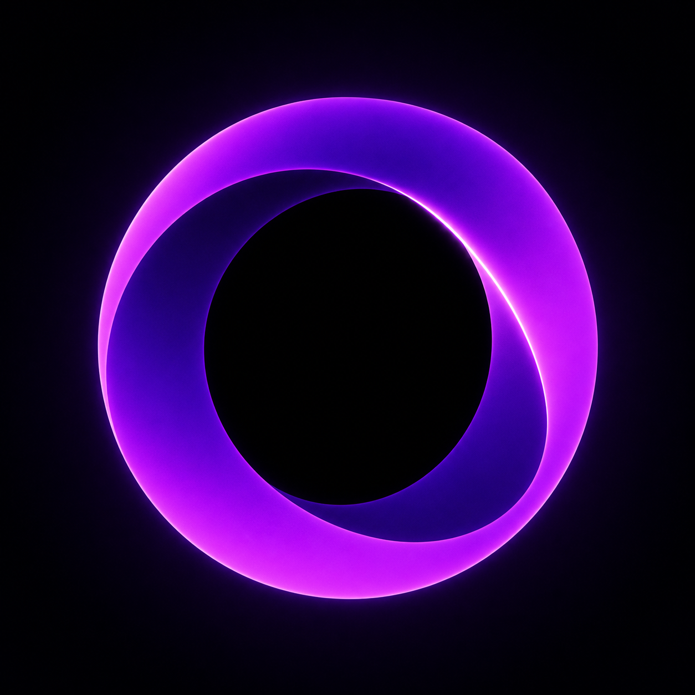
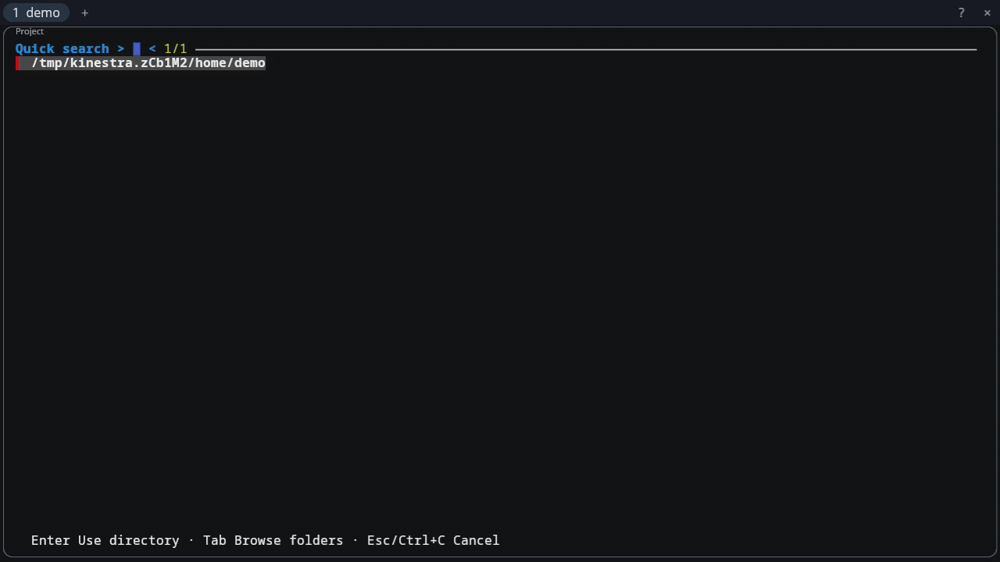

# Eon

*Build for Eons.*

Website: [eonterm.com](https://eonterm.com)



Eon is an agentic development environment (ADE): the terminal for humans and
agents to work together. It is a native Wayland workspace for long-running
work such as coding agents, builds, servers and editors. Its **terminals keep running after you detach the window** with
Alt+Shift+D. Run `eon window attach` and every tab, pane and terminal is
where you left it.

## Demo



## Why Eon

- **Detach the window, keep the work.** [Orbit](orbit/README.md) runs each
  terminal's process and state apart from the window. Alt+Shift+D detaches;
  `eon window attach` returns to the same terminals. Closing the window quits
  it, and `eon window stop` ends a detached window's terminals when you choose.
- **Made for coding agents.** Each tab has an Agent popup (**Alt+Shift+L**) that
  starts the first installed of Codex, Grok, OpenCode, Pi or Claude and keeps
  its session while hidden. When you're signed in, Codex and Claude quota appear
  in the top bar.
- **A tab per project.** Each tab starts in a directory you pick with Zoxide
  quick search or in Yazi, and that Yazi stays as the tab's Files popup. New
  panes open there, and the tab's Git popup runs LazyGit in it.
- **One pinned tool set.** Nushell, Helix, Yazi, LazyGit and Anima are pinned
  together, so every install gets the same tools.
- **One terminal emulator, natively drawn.** Unlike tmux inside another
  terminal, one emulator owns each terminal's state, and
  [Venus](venus/README.md) draws it with `wgpu` on Vulkan.

## Get started

You need **x86_64 Linux on native Wayland**. From v0.2.0, an Apple Silicon Mac
with macOS 14 or later also works, through Nix, as a
[preview](#status-and-limits).

### Linux, without Nix

Every release publishes a Linux archive and a small static installer as
[GitHub release assets](https://github.com/Yazelix/eon/releases), with SHA-256
checksums signed by the Eon release key and GitHub build attestations for the
archive, the installer and the checksum file. Your system needs glibc 2.39 or
newer, a Vulkan driver, `curl`, and `ssh-keygen` from OpenSSH 8.9 or newer
([all prerequisites](docs/MANUAL-BUNDLE.md#execution-and-host-boundary)).
Install 0.2.0:

```sh
v=0.2.0
base=https://github.com/Yazelix/eon/releases/download/v$v
mkdir -p ~/.config/eon && cd "$(mktemp -d)"
echo 'eon-release namespaces="eon-bundle" ssh-ed25519 RELEASE_PUBLIC_KEY' > ~/.config/eon/allowed_signers
curl -fL --remote-name-all "$base/eon-install-x86_64-linux" "$base/SHA256SUMS" "$base/SHA256SUMS.sig"
ssh-keygen -Y verify -f ~/.config/eon/allowed_signers -I eon-release -n eon-bundle -s SHA256SUMS.sig < SHA256SUMS &&
  sha256sum -c --ignore-missing SHA256SUMS &&
  chmod +x eon-install-x86_64-linux &&
  ./eon-install-x86_64-linux install "$base/eon-$v-x86_64-linux.tar.zst" --signers ~/.config/eon/allowed_signers
```

The `echo` line saves the Eon release public key. The next lines check that
the installer you downloaded matches the checksums that key signed, and the
installer then checks the archive the same way before it installs anything.
With the GitHub CLI, `gh attestation verify eon-install-x86_64-linux -R
Yazelix/eon` also confirms that this repository's release workflow built the
file.

The installer ends by printing `Run PREFIX/bin/eon`. Start Eon with that
path, or add that `bin` directory to your PATH; the installer changes no shell
startup file. The prefix is `$XDG_DATA_HOME/eon/install` when `XDG_DATA_HOME`
holds an absolute path, and `~/.local/share/eon/install` when it is unset,
empty or relative. To update later, set the two `[updates]` keys shown in
[Update](docs/USAGE.md#update), then run `eon update --install`. The
[installer guide](docs/INSTALLER.md) covers a dry run, another prefix,
rollback and removal; the [manual bundle guide](docs/MANUAL-BUNDLE.md) covers
checking and extracting the archive by hand.

### With Nix

With Git and Nix with flakes enabled, on Linux or an Apple Silicon Mac,
install the latest release, 0.1.16:

```sh
nix profile add --refresh github:Yazelix/eon/main
```

`main` always holds the latest release. For fixes before they are released,
install `github:Yazelix/eon/edge` instead; it gets every change as it lands.

To update from a terminal outside Eon, run `eon update --install`, then use
the reported launcher for fresh windows. For an older build without
source provenance, run `nix profile upgrade --refresh eon` once.
Windows already running keep their version until you close them. Tags such as
`v0.1.12` name one exact release and never update; if you installed from one,
run `nix profile remove eon` once, then the install line above.

### First run

Run `eon`. After a short animation (most keys skip it), pick a directory: press
Enter for a Zoxide match, or Tab to browse with Yazi and Alt+Enter to use a
folder. A terminal opens there.

On macOS, the Nix package also includes `Eon.app`. In Finder, use **Go > Go
to Folder** and enter `~/.nix-profile/Applications`, then open `Eon.app`.
Drag that app to the Dock to keep it there. A plain `nix profile` install
exposes the bundle in the profile; it does not copy it into `/Applications`.
Home Manager and nix-darwin users can use their existing application
integration; see [distribution](docs/DISTRIBUTION.md#nix-channel).
Opening Eon from Finder or the Dock with no terminal, and clicking its Dock
icon while it runs, are not yet tested; the
[macOS proof](docs/DEVELOPMENT.md#macos-proof-harness) describes the work that
remains.

| Shortcut | Action |
|---|---|
| Alt+/ | Show every shortcut |
| Alt+Shift+T | New tab |
| Alt+M | New pane in this column |
| Ctrl+Alt+M | New column side by side |
| Alt+H / Alt+L | Column or tab to the left or right |
| Alt+K / Alt+J | Previous or next pane |
| Alt+Shift+L | Agent popup |
| Alt+Shift+J | Git popup |
| Alt+Shift+Y | Files popup (Yazi) |
| Alt+Shift+M | Commands popup: search and run Eon commands |
| Alt+Shift+S | Sessions: switch, create or close a session in this window |
| Alt+Shift+D | Detach: hide the window, keep terminals running |
| Alt+Shift+Q | Quit this window; closing the window, or Command+Q on macOS, does the same |

Detach whenever you like. To come back or end work:

```sh
eon window attach        # return to your terminals
eon window ls            # list running windows
eon window stop ID       # end one window's terminals
```

`eon --help` lists every command. `eon versions` reports the pinned component
graph.

An optional, third-party [binary cache](docs/DISTRIBUTION.md#optional-binary-cache)
can avoid local builds for the `edge` builds it holds; tags have no guaranteed
coverage.

## Status and limits

Eon is in alpha: commands, configuration and behavior may still change between
releases. v0.2.0 enters beta. On Linux it installs without Nix or through Nix;
the Mac preview installs through Nix. It was proved on COSMIC and private Sway
before the move to one repository. Here, installed checks so far run on a
private headless Sway, plus a brief COSMIC launch check; the full desktop
proofs and the bounded Orca
[reader qualification](docs/CONTRACTS.md#eon-c8--durable-tab-and-pane-workspace)
await re-proof. Other compositors, non-systemd hosts and proprietary NVIDIA
drivers are unproved. Restarting the machine ends live terminals.

**Linux without Nix:** this release was checked from its GitHub release on
Fedora 44, and an earlier build on Ubuntu 26.04, both in virtual machines with
software rendering under Sway. GNOME, KDE and COSMIC sessions, physical GPUs
and other distributions with glibc 2.39 or newer are expected to work but are
not yet tested from the archive; reports welcome. The archive leaves out
eonbase, which stays Nix-only. The installer guide lists
[every limit](docs/INSTALLER.md#limits-of-the-published-install).

**Mac (preview):** From v0.2.0, Eon runs on Apple Silicon Macs as a preview,
installed with the same Nix command; until v0.2.0 is out, install
`github:Yazelix/eon/edge`. It needs macOS 14 or later and was checked on
macOS 15, 26 and 27. The preview makes no stability promise and is not
full support. Full Eon runs natively on Apple Silicon Mac minis, including at
Retina scale 2. Known issues:

- No notice appears when a detached window keeps running; `eon window ls`
  lists it.
- CJK text may look uneven on a non-Retina display.
- With stock macOS fonts, stacked accent marks may not show, and a long
  notice may be cut off at the window edge.
- Not yet tested: a physical Retina panel, a second display, screen readers
  such as VoiceOver, how the Dock and app switcher show Eon, Claude Code in
  the agent popup, and window translucency beyond one rented Mac.

Agent-finish sounds and desktop notifications are planned, Linux first.
[EON-C7](docs/CONTRACTS.md#eon-c7--native-linux-wayland-and-apple-silicon-macos)
has the full list of Mac gaps. Intel Macs are out of scope. Mac reports are
welcome: [open an issue](https://github.com/Yazelix/eon/issues/new).

[Report a problem](https://github.com/Yazelix/eon/issues/new?template=bug_report.yml).

## Guides

- [Using Eon](docs/USAGE.md): session controls, commands, Anima, eonbase and troubleshooting.
- [Configuration](docs/CONFIGURATION.md): terminal, shell, popups, agent quota and managed tools.
- [Distribution](docs/DISTRIBUTION.md): Nix composition, the binary cache and release policy.
- [Linux installer](docs/INSTALLER.md) and [manual Linux bundle](docs/MANUAL-BUNDLE.md): the Nix-free install, its trust checks, rollback and removal.
- [Changelog](CHANGELOG.md): accepted user-visible changes.

## Contributing

Contributors and coding agents start with [AGENTS.md](AGENTS.md) and
[Development](docs/DEVELOPMENT.md). [Architecture](docs/ARCHITECTURE.md) and
[contracts](docs/CONTRACTS.md) record component ownership, exact product
boundaries and proof. Pull requests from outside the Yazelix organization are
read as reference and reimplemented here, with the author credited as
co-author; see [Outside Contributions](docs/AGENT-RULES.md#outside-contributions).
