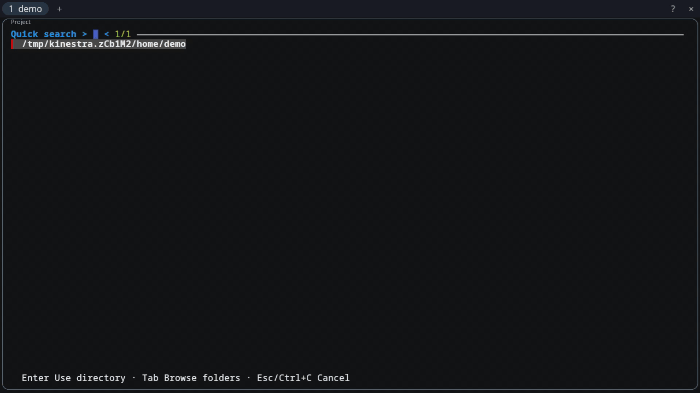

# Venus

Venus is Eon's native client: it renders Orbit Sessions and sends user input
back to their authoritative runtime. In an Eon workspace, Venus draws the tabs,
pane stack, and popups from Eon's workspace state.

## Demo

[](../assets/demo/eon-demo.mp4)

[Watch the MP4](../assets/demo/eon-demo.mp4) of the composed Linux alpha.

## Run locally

The proved host is **x86_64 Linux on native Wayland with Vulkan**. With an Orbit
server running, point Venus at its Unix socket:

```sh
cargo run --locked -- /path/to/orbit.sock
```

Venus can also start before Orbit and reconnect when the socket appears. To
view an Eon workspace, pass its workspace socket instead:

```sh
cargo run --locked -- --workspace /path/to/eon.sock
```

In full Eon, **Alt+Shift+N** opens an independent Eon window. The native
Shortcuts viewer lists it; Eon supplies the exact launcher executable.

Eon can supply its running version through `--eon-version` in workspace mode.
The read-only label uses spare header space and yields before tabs and controls.

Eon can supply Codex and Claude quota facts in the same header. Read-only chips
show Codex’s white mark and Claude’s original orange splat alongside remaining
percentages, with reset and freshness details on hover and in
accessibility. Missing reset times stay explicitly unavailable. Narrow windows condense or hide optional chips before controls.

Workspace windows show a compact shortcut hints bar. **Alt+Shift+B** hides or
shows it for that window; **Alt+/** opens the complete Shortcuts viewer.

[Running Venus](docs/LAUNCH.md) covers fonts, window options, attachment, and
supervised startup. Apple Silicon macOS native proof awaits re-proof in this
repository, and macOS remains unsupported as a product target.

## Read more

- [Interaction](docs/INTERACTION.md): links, workspace controls, scrolling, selection, and clipboard.
- [Presentation and ownership](docs/PRESENTATION.md): visual behavior, component boundaries, and limits.
- [Development checks](docs/DEVELOPMENT.md): local and native proof commands.
- [Contract index](docs/CONTRACTS.md): accepted behavior, exact revisions, and remaining gaps.
- [References](docs/REFERENCES.md), [crate decisions](docs/CRATES.md), and the [memory comparison](docs/benchmarks/venus-memory-2026-09-08.md): design evidence.

## License

The copyright holder offers the project-owned source history under
[Apache-2.0](LICENSE). Provider marks have separate copyright attribution and
trademark terms in [third-party notices](THIRD_PARTY_NOTICES.md).

## LOC scorecard

The scorecard counts tracked handwritten text and code. It excludes `.git/`,
Beads data, lock files, and generated artifacts, including rendered `AGENTS.md`,
benchmark CSV data, and disposable qualification patches.

| Surface | Lines |
|---|---:|
| Agent policy inputs | 220 |
| README | 82 |
| Repository attributes and ignore rules | 7 |
| License | 201 |
| Third-party notices | 69 |
| Contracts and references | 2,064 |
| Guides | 473 |
| Memory benchmark report | 158 |
| Crate decisions | 335 |
| Changelog | 12 |
| Rust source, including unit tests | 23,272 |
| Rust integration tests | 1,047 |
| Cargo manifest | 37 |
| **Total** | **27,977** |
